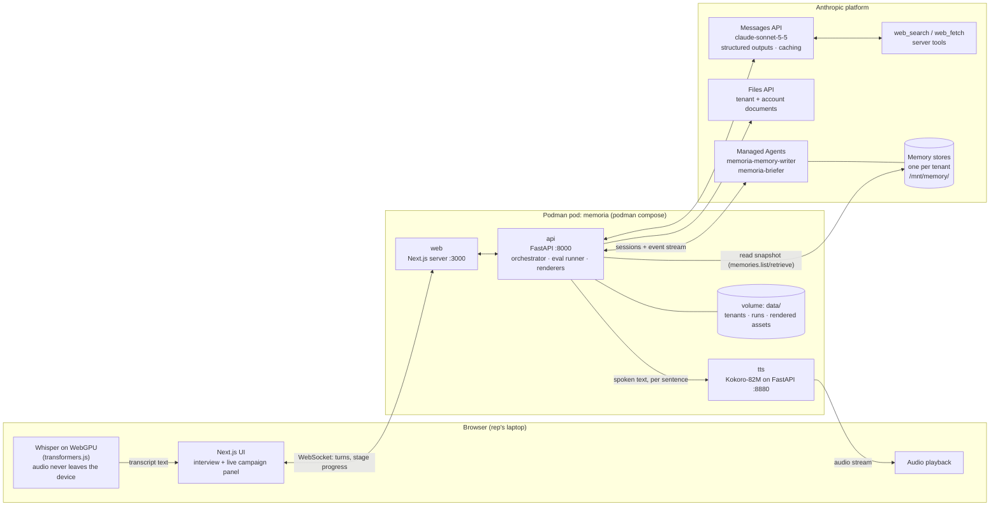
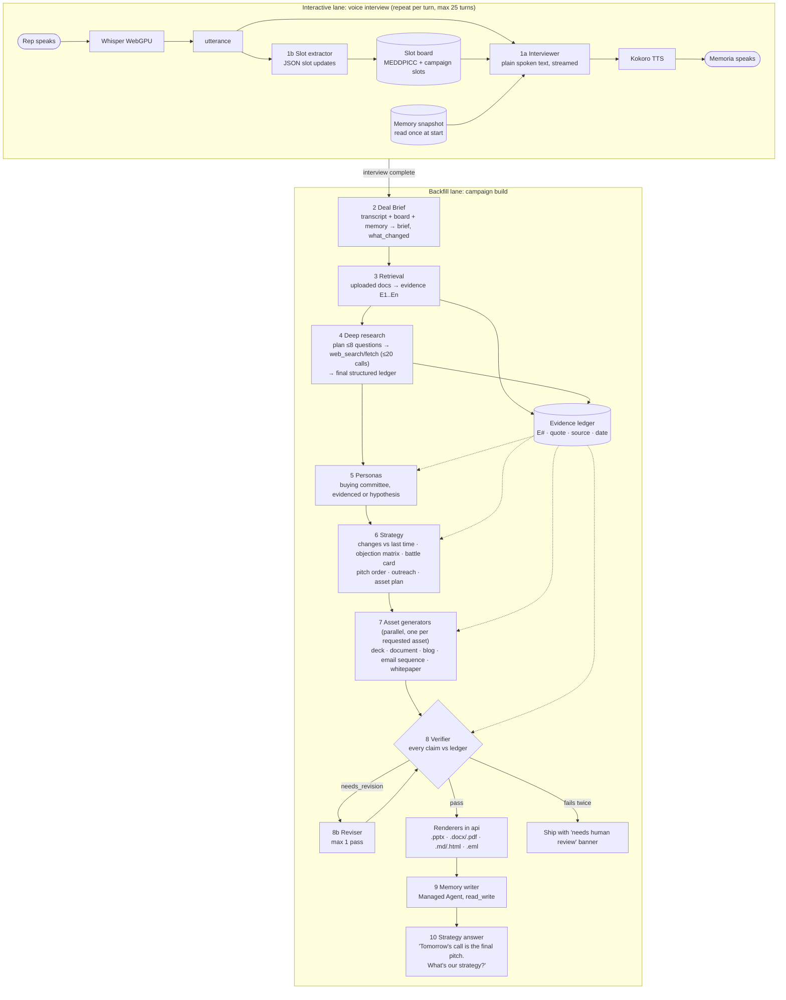
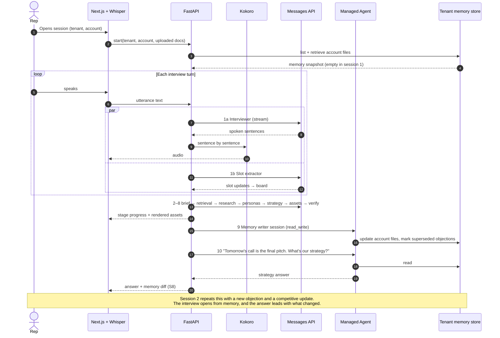
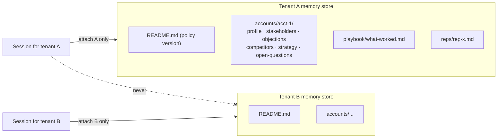
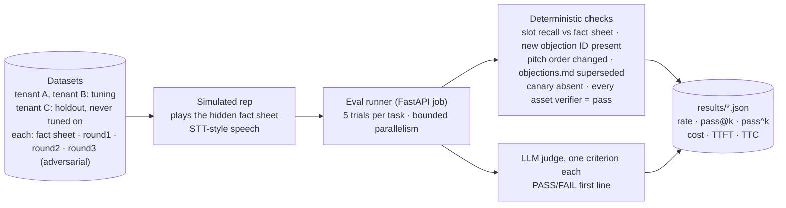

# Memoria — Architecture

Memoria is a voice-first sales engineer agent that works for any company and any product. It interviews a sales rep, retrieves and researches evidence, builds target personas, and produces a campaign: decks, documents, blogs, email sequences and whitepapers. Its memory is per company (tenant), so it gets sharper on each account over time.

Stage prompts, schemas and call settings: [`../backend/src/memoria/chain_prompts.py`](../backend/src/memoria/chain_prompts.py).

## 1. System and deployment

| Container | Role | Notes |
|---|---|---|
| `web` | Next.js app; serves the UI and Whisper model files | Whisper weights are cached by the browser after first load |
| `api` | FastAPI: runs the chain, keeps session state, renders assets, runs evals | The only container holding the Anthropic key (from `.env`, never baked into the image) |
| `tts` | Kokoro-82M behind a small FastAPI | Runs on CPU under Podman on macOS (no GPU passthrough) |

## 2. The chain

Two lanes (Constitution §7.7). The **interactive** lane is the voice interview: streamed, short, and fast. The **backfill** lane builds the campaign while the UI shows each stage's progress.

| # | Stage | Runtime | Output | Gate / failure behavior |
|---|---|---|---|---|
| 1a | Interviewer | Messages, streamed, effort low, 200 tokens | Spoken turn | One question per turn; refuses to invent statistics |
| 1b | Slot extractor | Messages, structured | Slot updates with verbatim quotes | `conflict` status when the rep contradicts memory |
| 2 | Deal Brief | Messages, structured | Brief + `what_changed` + stable objection IDs | Unknown → null; transcript beats memory |
| 3 | Retrieval | Messages + document blocks (citations) | Ledger entries | Only what documents state; conflicts recorded |
| 4 | Deep research | Messages tool loop, then a structured final call with `tool_choice: none` | Ledger entries + question outcomes | ≤20 tool calls; "unanswerable" is a valid outcome |
| 5 | Personas | Messages, structured | Buying committee | Each statement is evidenced or labelled a hypothesis |
| 6 | Strategy | Messages, structured, effort high | Full campaign strategy | Must list changes from the previous strategy |
| 7 | Assets | Messages, structured, parallel | Content JSON per asset | `[E#]` markers on every fact; placeholders, never invention |
| 8 | Verifier | Messages, structured, effort high | Per-claim verdicts | `pass` only if every claim is supported |
| 9 | Memory writer | Managed Agent + tenant memory store | Updated `/mnt/memory/` | Update, never duplicate; objections never deleted |
| 10 | Strategy answer | Managed Agent, memory read-only | The track's test-question answer | Leads with "Since our last session: ..." |

**Why the model writes JSON and the API renders the files:** asset content comes back as structured output, and deterministic Python renderers (python-pptx, python-docx, markdown → HTML/PDF) build the files. That keeps formatting off the model's output budget (§7.5), makes every claim checkable before rendering, and means files never have to leave an agent container.

## 3. One round, end to end (Card D)

## 4. Memory and tenant isolation

- **Isolation (S5):** one memory store per tenant, and a session attaches only its own tenant's store. The eval plants a unique canary string in each tenant's data and fails if it ever appears in another tenant's output.
- **Policy (S1):** the always and never lists live in `MEMORY_WRITER_SYSTEM`. Objections change status (`open → answered | superseded`) with a date and reason; they are never deleted.
- **Contradictions (S3):** an unexplained conflict goes to `open-questions.md` as an "unresolved conflict", and the old value stays in place until the rep confirms.
- **Memory diff (S8):** the API snapshots the store before and after each session and shows the diff in the UI. This is the headline of the demo.

## 5. Evaluation

Failed runs (API errors, timeouts) are recorded separately from failed tasks. A task passes only if **every** check passes.

## 6. Open items to verify (not yet confirmed)

- That `claude-sonnet-5-5` is enabled for this key, along with the `web_search`/`web_fetch` server tools. Check both with `institutional-memory/test_api_access.py`.
- Voice time to first token for the interviewer at effort low. If it's too slow, drop to Haiku for stage 1a only, and measure before and after.
- Whether `MEMORIA_CORE` plus the stage and tenant blocks reaches the 2,048-token caching minimum on Sonnet. Confirm with `usage.cache_read_input_tokens`.
- Kokoro CPU throughput in Podman on macOS when sentences are synthesized in parallel with streaming.
